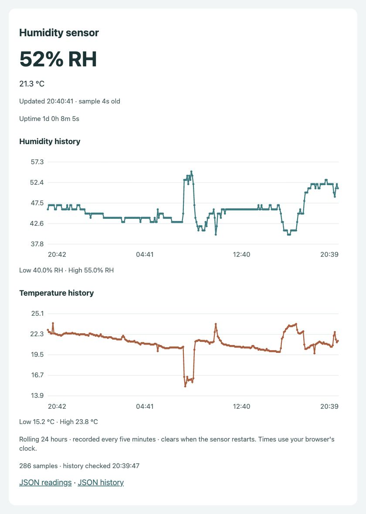

# ESP-01S humidity monitor

A small Wi-Fi temperature and humidity monitor for an **ESP-01S and ESP-01S DHT11 v1.0 carrier**. Open its local webpage for live readings and recent history. After the first USB installation, firmware updates can run over Wi-Fi with a device-specific password.



*Captured from the running sensor on 15 November 2026. Readings and charts show the device's state at capture time.*

## Features

- Temperature and relative humidity sampled every five seconds.
- A rolling 24-hour history, recorded every five minutes on the ESP even when the webpage is closed.
- Humidity and temperature charts with low/high values.
- Uptime display with stale-connection indication and automatic Wi-Fi light sleep between requests.
- Local JSON endpoints for readings, history and device information.
- Browser-based Wi-Fi provisioning using WiFiManager.
- Password-protected ArduinoOTA updates, with a helper that keeps the password out of command-line arguments and logs.
- Explicit gaps for failed sensor readings rather than stale measurements.

History is held in RAM (up to 289 points). Restarting or unplugging clears it. The OTA helper can preserve and restore the history around an update with `--preserve-history`; a raw/manual OTA update still clears it.

## Hardware

- ESP-01S / ESP8266 with 1 MB flash.
- ESP-01S DHT11 v1.0 carrier, with DHT11 data connected to **GPIO2**.
- A stable power supply appropriate to the carrier and a USB programmer for the first installation.

Disconnect power before moving boards or changing wiring. Bare ESP-01S power and serial logic are 3.3 V; check the carrier's input rating separately. In testing, an unsuitable supply caused repeated restarts and lost history; returning to the stable supply restored operation.

## Build

Install Arduino CLI and Python 3. The local chart/buffer tests also use Node.js and a C++ compiler.

```sh
arduino-cli core update-index --additional-urls https://arduino.esp8266.com/stable/package_esp8266com_index.json
arduino-cli core install esp8266:esp8266@3.0.2 --additional-urls https://arduino.esp8266.com/stable/package_esp8266com_index.json
python3 setup_dependencies.py
python3 setup_ota.py
sh build.sh
```

The dependency installer downloads the official release archives listed in `dependencies.lock.json` and verifies their SHA-256 checksums. On an existing working installation, keep the populated `vendor/` directory; the installer intentionally refuses to overwrite it.

The build uses Generic ESP8266, 1 MB flash / 64 KB filesystem, DOUT, 40 MHz. It writes `build-local/HumiditySensor.ino.bin`. Dependencies are pinned to WiFiManager 2.0.17, Adafruit DHT 1.4.6 and Adafruit Unified Sensor 1.1.15.

`setup_ota.py` creates a unique password in `secrets/ota-password.txt` and a matching hash header in `HumiditySensor/ota_secrets.h`. Rerunning it retains the existing password. Keep both files private; neither is committed.

## First installation and Wi-Fi

1. Connect the ESP to a programmer and enter its serial bootloader mode. GPIO0 must be low at reset; follow the programmer's controls.
2. Upload the application at address `0x0`, using DOUT, 40 MHz and 1 MB flash. For example, with esptool 5.x and the chip already in programming mode:

   ```sh
   esptool --chip esp8266 --port YOUR_SERIAL_PORT --baud 115200 --before no-reset --after hard-reset write-flash --flash-mode dout --flash-freq 40m --flash-size 1MB 0x0 build-local/HumiditySensor.ino.bin
   ```

3. Release GPIO0 / select normal run mode and reset. Do not erase all flash when preserving previously saved Wi-Fi settings.
4. If the ESP cannot join saved Wi-Fi, connect to `Humidity-Setup-<chip-id>` using the provisioning password `humidity-setup`. Open `http://192.168.4.1` and configure a 2.4 GHz network. This shared provisioning password is separate from the unique OTA password.
5. Rejoin your network. Serial output at 115200 baud prints the IP and hostname. Open `http://humidity-<chip-id>.local/`, or use the DHCP address if mDNS is unavailable.

## Wireless updates

After the OTA-enabled build has been installed over USB:

```sh
sh build.sh
python3 upload_ota.py --host humidity-YOUR_CHIP_ID.local --expected-hostname humidity-YOUR_CHIP_ID --preserve-history
```

An IP address works with `--host` too. For repeated use, you can save defaults locally in the ignored `secrets/device.json`:

```json
{"host": "humidity-YOUR_CHIP_ID.local", "hostname": "humidity-YOUR_CHIP_ID"}
```

Then `python3 upload_ota.py` uses those defaults. The helper checks firmware compatibility, optional device identity, image/password consistency and available flash space. It finds `espota.py` from the installed ESP8266 core on macOS, Linux or Windows; use `--espota /path/to/espota.py` for a custom installation.

Use the same trusted local network. ArduinoOTA uses password-based Digest-MD5 authentication, not TLS or signed firmware. The ESP listens on UDP 8266 and connects back to a temporary TCP listener on the uploading computer. Keep OTA support in future builds. Successful updates reboot, preserve saved Wi-Fi settings and clear RAM history.

With `--preserve-history`, the helper first saves and reads back a local JSON backup, then restores the still-recent points and any new startup samples after reboot. Restore-capable firmware (`history-uptime-v6` onward) must be the image being installed. Run `setup_ota.py` again before building an older checkout to add its history-authentication hash; the saved OTA password is retained. Restoration uses HTTP Digest authentication with that same password, a fixed-size streaming parser and at most 289 records. Invalid or unauthenticated imports do not replace the current history. Natural 24-hour expiry and bounded capacity still apply. The helper verifies the restored count and values; if restoration fails, it reports an error and retains the local backup.

## API

| Endpoint | Response |
| --- | --- |
| `/` | Dashboard with current readings and history charts |
| `/api/readings` | `ok`, `humidity_percent`, `temperature_c`, `sample_age_ms`, `uptime_ms` |
| `/api/history` | `interval_ms`, `window_ms`, chronological `readings` with sample ages and measurements |
| `/api/device` | Firmware identifier, OTA availability, hostname, sketch size and free update space |
| `/api/diagnostics` | Boot reset reason, recorded restart intent, heap health, Wi-Fi signal and observed disconnects |
| `/api/debug/heap` | Last 48 one-minute heap/Wi-Fi samples in a fixed-size RAM ring |
| `/api/history/restore` | Digest-authenticated multipart binary history import used by the OTA helper |

Live sensor failures return HTTP 503 and null measurements. History retains null entries as gaps. Measurements are available without authentication on the local network; OTA uploads require the generated password. No credentials or password hashes are returned by the API.

Sample times are derived from ages, not an ESP real-time clock. The dashboard uses the browser's clock to label the charts. Save the export time alongside a history export if you need approximate absolute timestamps later.

### Investigating restarts

The firmware deliberately reboots after three minutes continuously disconnected from Wi-Fi. It also reboots after provisioning times out or an OTA update succeeds. These can clear history without an application crash.

Starting with `history-uptime-v5`, `/api/diagnostics` reports the core's reset reason and reset information, plus a marker for the last intentional reboot (`wifi_timeout`, `setup_timeout`, `ota_update`, or `none_recorded`). Markers and a boot counter use checksummed RTC memory outside the area reserved for OTA. RTC data can be lost on power removal; the counter is not an all-time reboot count, and `none_recorded` does not by itself prove a power fault or crash. The first upgrade from older firmware cannot recover an earlier reset cause.

Heap fields report current free memory, the minimum observed at loop boundaries, largest free block and fragmentation. Wi-Fi disconnects count transitions observed by the main loop, so brief events may be missed. These diagnostics help distinguish later faults; they do not establish a cause without observing the failure. Wi-Fi light sleep and recovery behaviour are unchanged in this diagnostic build.

Debug logging does not append files to flash. Its 48-point RAM ring overwrites old records; history remains capped at 289 points. Compile-time checks limit the combined history/import/log/output buffers to 10 KB. History responses use a fixed 1 KB output buffer. Large endpoints return HTTP 503 when free heap is below 8 KB or the largest free block is below 4 KB. The uploader checks available OTA space before writing. These bounds prevent log growth, but do not prove an unrelated crash or power fault is fixed; inspect `/api/diagnostics` and the heap trend over time.

## Measurement accuracy

The DHT11 is a basic sensor. Nearby ESP/carrier heat is an **unconfirmed explanation** for the temperature/RH discrepancy observed on the original unit. Owner reports and manufacturer guidance support investigating thermal coupling, but a settled reference comparison is needed before applying an offset or modifying hardware. The firmware applies no temperature or humidity compensation.

Relevant reading:

- [Aosong DHT11 datasheet, section 7.4](https://cdn-shop.adafruit.com/datasheets/DHT11-chinese.pdf#page=5): keep the sensor away from heat sources and reduce thermal coupling.
- [Firsthand ESP-01/DHT11 carrier report](https://community.home-assistant.io/t/esp8266-01-and-dht11-board-configuration-question/98091/5), plus [follow-up wiring issues](https://community.home-assistant.io/t/esp8266-01-and-dht11-board-configuration-question/98091/13).
- [Sensirion thermal design guidance](https://sensirion.com/media/documents/FC5BED84/662A065D/Sensirion_Temperature_Sensors_Design_Guide_V1.pdf#page=10): temperature compensation also requires corresponding RH correction.

## Tests and verification

```sh
sh test.sh
```

The offline tests cover sampling intervals, buffer wrap, missing samples, uptime rollover, chart handling of empty/boundary/missing data, and OTA uploader preflight checks. Building verifies the ESP8266 target. A separate opt-in live test checks that OTA rejects a deliberately incorrect authentication response without sending firmware:

```sh
python3 tests/ota_auth_test.py SENSOR_IP_OR_HOSTNAME
```

The original hardware was verified with real sensor readings, growing history, rejection of wrong OTA authentication and a successful password-authenticated wireless upload. A full 24-hour retention/endurance test has not been recorded. Repository preparation does not upload new firmware to the device.

Local credentials, firmware binaries, flash backups, telemetry exports, logs and installation-specific notes are excluded from Git. Third-party libraries remain in the ignored `vendor/` directory and retain their upstream licences.
